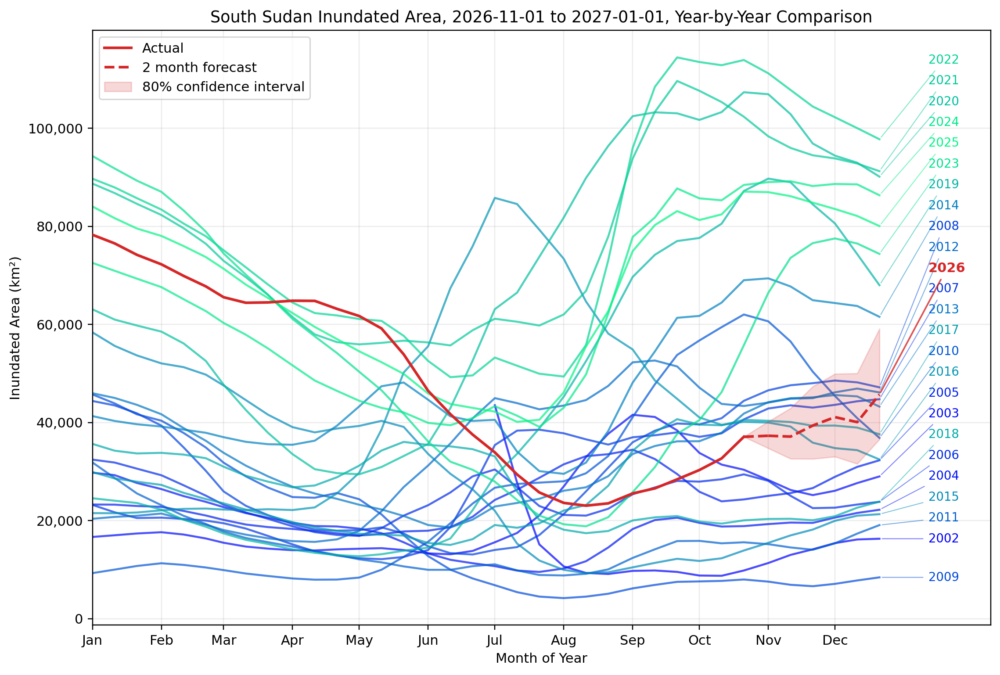
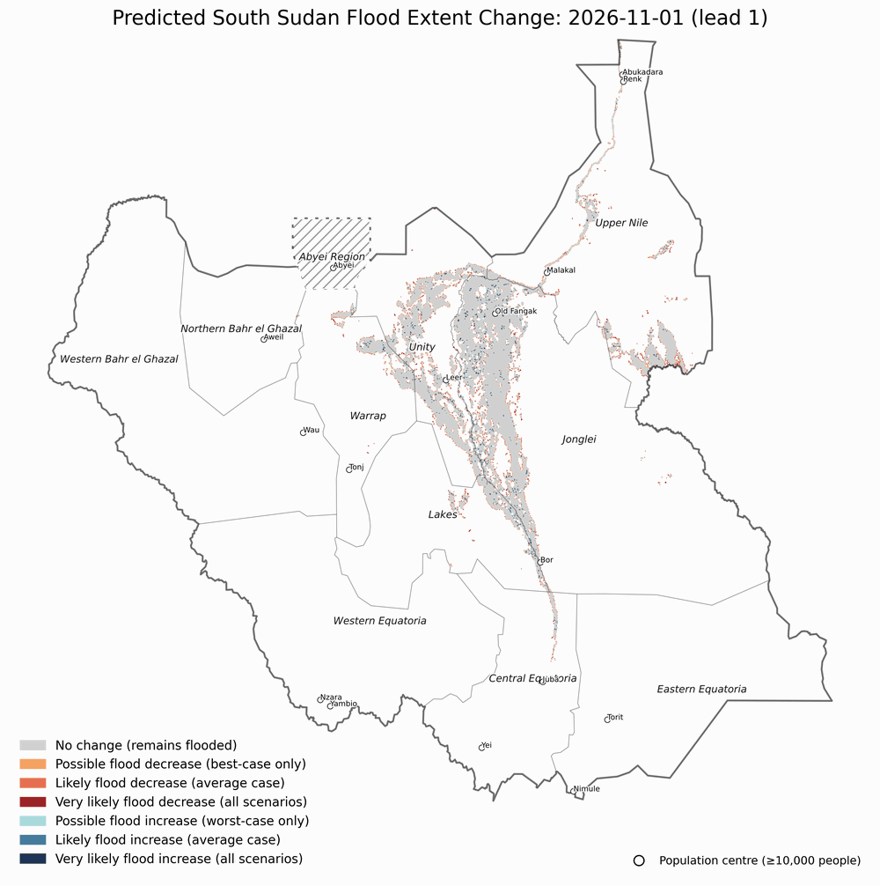

# INFLOW-AI Flood Inundation Prediction

INFLOW-AI builds dekadal flood-inundation forecasts for the INFLOW study area.
The repository contains three connected workflows:

1. downloading and processing target and predictor data;
2. selecting a temporal forecasting model through staged ablation experiments;
3. operational temporal and spatial prediction using the selected temporal
   model and a separately trained ConvLSTM.

VIIRS is the sole inundation target and uses a dekadal timeline.

## S-EAP early-action trigger

After every South Sudan temporal forecast, deployment calculates the maximum
extent across all six leads minus the observed minimum in the annual window
ending on the final forecast dekad. It compares that increase with equivalent
historic annual maximum-minus-minimum ranges. Exceeding the 80th, 90th or 95th
percentile activates a Moderate, Severe or Extreme trigger respectively. The
same anchored-window calculation is applied nationally and to every state and
county. An active trigger writes `TRIGGER ACTIVATED.txt`; recalculation removes
an obsolete file when no threshold is exceeded. For counties whose historic
annual ranges are entirely zero or unavailable, a warning is suppressed unless
the maximum forecast extent covers at least 5% of the county, filtering isolated
pixel noise. The latest national calculation is reported in km².

The generated block below is refreshed by `__main__.py` after every trigger
calculation so it corresponds to the most recent prediction.

<!-- EARLY_ACTION_TRIGGER_STATUS_START -->


| Latest trigger calculation | Value |
|---|---|
| Highest trigger level | **Not activated** |
| Annual window | 2025-12-21 to 2026-12-21 |
| Forecast peak date | 2026-12-21 |
| Maximum forecast extent | 45,712 km² |
| Annual-window minimum extent | 23,049 km² |
| Forecast increase | 22,663 km² |
| Moderate threshold | 60,205 km² |
| Severe threshold | 73,438 km² |
| Extreme threshold | 76,847 km² |
| Historic annual windows | 23 |
| Trigger file | Not generated |
<!-- EARLY_ACTION_TRIGGER_STATUS_END -->

### Latest deployed prediction

This generated block is refreshed after `__main__.py` completes temporal and
spatial prediction outputs.

<!-- DEPLOYMENT_STATUS_START -->
| Latest deployed prediction | Value |
|---|---|
| Completed/retrained at (UTC) | 20261128T145607Z |
| Selected experiment | `20261127T210332Z` (elastic_net) |
| Target | `percent_inundation_ssd` |
| Forecast origin | 2026-10-21 |
| Forecast range | 2026-11-01 to 2026-12-21 |
| Prediction directory | [`predictions/inundation_predictions_ssd_2026-11-01_to_2026-12-21`](predictions/inundation_predictions_ssd_2026-11-01_to_2026-12-21) |
| Recent prediction plot | [prediction_year_by_year_comparison.png](predictions/inundation_predictions_ssd_2026-11-01_to_2026-12-21/temporal_predictions/prediction_year_by_year_comparison.png) |
| Spatial lead-time animation | [spatial_predictions_leads_1_to_6.gif](predictions/inundation_predictions_ssd_2026-11-01_to_2026-12-21/spatial_predictions/spatial_predictions_leads_1_to_6.gif) |
| Spatial outputs | 101 |




<!-- DEPLOYMENT_STATUS_END -->

### Latest county-level early warnings

This generated block is refreshed by the operational spatial pipeline. County
warnings compare the maximum six-dekad forecast increase above the current
annual-window minimum with the 80th, 90th and 95th percentiles of historic
annual flood-extent ranges. Where no historic flood signal exists, the maximum
forecast must additionally cover at least 5% of the county.

<!-- COUNTY_PREDICTIONS_STATUS_START -->


**Counties with active early warnings:**

None.

Detailed trigger results: [county CSV](<predictions/inundation_predictions_ssd_2026-11-01_to_2026-12-21/county-level predictions/county_early_action_triggers.csv>) and
[state CSV](<predictions/inundation_predictions_ssd_2026-11-01_to_2026-12-21/county-level predictions/state_early_action_triggers.csv>).
<!-- COUNTY_PREDICTIONS_STATUS_END -->

## Requirements

- Python 3.11 or 3.12 is recommended;
- network access for initial downloads and source updates;
- TensorFlow/Keras for spatial training and inference;
- the geospatial system libraries required by Rasterio and GeoPandas.

Python 3.13 can run much of the temporal pipeline, but current TensorFlow builds
used by this project require Python 3.12 or earlier.

```bash
python3 -m venv .venv
source .venv/bin/activate        # Windows: .venv\Scripts\activate
python3 -m pip install -r requirements.txt
```

Run commands from the repository root.

> **First-run duration:** the first data-preparation or deployment run can take
> a very long time because it downloads and processes the complete historical
> VIIRS, TAMSAT and ECMWF archives. Later runs reuse cached downloads and
> processed products and normally fetch or process only new data.

### Windows (PowerShell)

Python 3.12 is recommended for the TensorFlow dependency. From the repository
root in PowerShell:

```powershell
py -3.12 -m venv .venv
.\.venv\Scripts\Activate.ps1
python -m pip install -r requirements.txt
$env:PYTHONPATH = "."
$env:MPLCONFIGDIR = "$env:TEMP\inflow-matplotlib"

# Prepare data (normally needed only for the first run or a full rebuild)
python -m model.temporal.data.prepare_temporal_data

# Optional model-selection experiments
python -m model.temporal.ablation.run_temporal_ablation

# Operational prediction
python __main__.py
```

If script execution is disabled, allow locally created activation scripts for
the current PowerShell process with:

```powershell
Set-ExecutionPolicy -Scope Process -ExecutionPolicy Bypass
```

## Pipeline overview

| Stage | Command | Result |
|---|---|---|
| Prepare data | `python3 -m model.temporal.data.prepare_temporal_data` | Downloads or updates raw sources and creates target-aligned HDF5 and temporal CSV products |
| Temporal ablation | `python3 -m model.temporal.ablation.run_temporal_ablation` | Runs configured experiments and writes the best deployable temporal-model metadata |
| Spatial training | `python3 -m model.spatial.train_convlstm` | Trains the multi-horizon ConvLSTM and optionally runs spatial validation |
| Spatial validation only | `python3 -m model.spatial.evaluate_spatial_model` | Compares a saved spatial model with persistence and GloFAS baselines |
| Deployment | `python3 __main__.py` | Updates operational data, retrains the selected temporal model, and exports temporal and spatial forecasts |

Temporal data preparation and ablation use the focused `data` and `ablation`
subpackages shown above.

## 1. Data preparation

Configure `runtime.target_product` and run:

```bash
python3 -m model.temporal.data.prepare_temporal_data
```

No trained model is required. The command prepares:

- VIIRS inundation targets;
- Victoria, Albert and Kyoga lake data;
- gauge rainfall and teleconnections;
- gridded TAMSAT rainfall, cumulative rainfall and soil moisture;
- ECMWF rainfall forecasts;
- optional HydroATLAS basin attributes.

Daily TAMSAT rainfall and moisture are streamed into complete target periods
using precomputed masks. Their HDF5 grids and regional temporal CSV summaries
are created together and appended when possible. Existing valid raw downloads
are reused, so processed outputs can be rebuilt without downloading everything
again.

ECMWF processing combines:

- historical hindcasts from `sources.ecmwf.hindcast_base_url`;
- the archived 2025 operational forecasts;
- the real-time archive used for 2026 and later forecasts.

For each target period, the latest eligible initialization is ensemble-averaged
into four non-overlapping rainfall windows: days 1–10, 11–20, 21–30 and 31–40.
The compact coarse-grid HDF5 is used by spatial training, while regional values
are exported to `ecmwf_hindcasts_temporal.csv` for temporal models. Ensemble
size is stored per initialization because archives can contain different member
counts. Existing initialization selections are checked before expensive
extraction and reprojection.

NetCDF run metadata is cached incrementally at
`paths.downloads.ecmwf_inventory_cache`. Each entry is keyed by file path,
size, modification time and archive type. Unchanged files are not reopened on
later runs, while new or changed files are inspected and added to the cache.
The cache is saved after every inspected file, so interrupting inventory loses
at most the file currently being read.

If inventory cannot open a downloaded NetCDF, the file is moved aside with a
`.corrupt` suffix and downloaded again from its original archive. A file that
still fails validation is quarantined and skipped so the remaining archive can
be processed; missing periods remain visible to the mandatory data preflight.

Processed target-aligned products are written under:

```text
data/historic/<target-product>-aligned/
```

Raw source files remain under `data/downloads/`.

VIIRS has separate historical and operational paths. Only immutable maps from
the configured `final/` archive are written to the historical HDF5 and temporal
CSV used for training and validation. During deployment, the pipeline selects
the highest available version of every non-final dekad from
`prelim/prelim_versions.csv` and adds it to a disposable view under
`data/operational/`. These provisional maps inform the current forecast but
never enter the historical record; a preliminary dekad disappears from the
operational overlay automatically when its final map becomes available.

### Optional basin-attribute regeneration

`processing/data_cleaning/process_basin_attributes.py` reproduces the static
HydroATLAS PCA layers used by the spatial model. It rasterizes basin membership
onto the configured reference grid, imputes and scales numeric attributes,
encodes selected categorical levels, and retains PCA components meeting the
configured variance threshold. It also writes metadata, source hashes and the
fitted preprocessing parameters.

This step is disabled by default because the HydroATLAS GeoPackage is not
downloaded automatically. Set the source path and deliberately enable
replacement before running normal data preparation:

```yaml
basin_attributes_processing:
  enabled: true
  basin_path: "data/maps/hydroatlas/inflow-basin-atlas.gpkg"
  overwrite_existing: true
```

Alternatively, run it explicitly:

```bash
python3 -m processing.data_cleaning.process_basin_attributes --force
```

Spatial training currently consumes the first saved PCA layer; the complete
component stack is retained for reproducibility.

## 2. Temporal ablation

Temporal ablation is optional for normal prediction when the repository already
contains `model/temporal/best_temporal_model.json` and every weight,
preprocessor and feature-selection artifact referenced by it. In that case,
skip this section and run deployment directly. Run ablation when comparing new
models or features, changing the target or forecast design, or regenerating
missing model artifacts.

Run the experiment grid defined in `config.yaml`:

```bash
python3 -m model.temporal.ablation.run_temporal_ablation
```

Before creating any model, a mandatory data preflight prints the target-series
length and date range plus row coverage and numeric missingness for every
aligned CSV. It also checks the corresponding gridded HDF5 products. Enabled
ECMWF features receive additional availability, consecutive-gap and trailing-
gap checks. Unsafe inputs stop the complete experiment grid before training;
the detailed report is written to `model/temporal/ablation/data_preflight.json`.

When `ablation.enabled: true` and complete experiment lists are present, the
configuration takes precedence over command-line defaults.

### Staged experiment design

With `ablation.staged.enabled: true`, ablation has two stages:

1. **Model selection:** vary model, target transformation, autoregression,
   cutoff date and target product while holding feature blocks fixed.
2. **Feature-block ablation:** take the top `top_n_model_configurations` under
   `ranking_metric` and evaluate the configured removal blocks, such as no
   ECMWF, no target lags, no historical feature lags, or no lags.

The current default grid tests random forest, elastic net and Transformer
models on raw, first-differenced and seasonally differenced targets. Edit
`ablation.experiments` to change that grid.

For tabular candidates, each forecast lead has its own model and predicts its
target directly from the common forecast origin (`t=0`); predictions are not
recursively accumulated. The Transformer produces all leads jointly. Target
transformations are leakage-safe:

- `first_differenced` predicts the cumulative raw change from `t=0` to each lead;
- `seasonally_differenced` first forms single-period inundation differences,
  estimates their dekadal means and standard deviations from training data
  only, and standardizes the direct cumulative change for each lead;
- `deseasonalised` uses training-only month/day level means and standard
  deviations; and
- `differenced_anomaly` uses a direct origin-relative change, so inverse
  reconstruction never requires a future observation.

`ablation.experiments.seasonally_standardize_features_values` defaults to
`[false, true]`. Consequently, every stage-one configuration is tested both
with ordinary train-only scaling and with all predictors first standardized by
their training-only month/day means and standard deviations. The selected
setting is recorded in `dataset_seasonally_standardized_features` and reused by
deployment retraining.

Feature selection is lead-specific but cached across model candidates. For a
given dataset, target setup, lead and feature-block combination, selection is
computed once and reused so model architectures receive comparable inputs.
Near-constant and highly correlated candidates are removed according to
`ablation.pipeline.feature_selection`.

The temporal Transformer is a joint non-autoregressive encoder-decoder model:
the encoder receives historical hydrometeorological sequences, while the
decoder receives the four ECMWF forecast windows. Decoder self-attention and
cross-attention produce all configured target horizons simultaneously.
When `ablation.pipeline.transformer.history_length` is a list, such as
`[12, 24, 36]`, the ablation grid expands it into one separately logged
Transformer experiment per history length. Tabular candidates are not
duplicated by this Transformer-only setting.

Transformer results are logged and ranked during ablation, but joint
multi-horizon models are not currently published as the operational best model.
Deployment currently requires a lead-specific tabular model.

### Ablation outputs

Every run, including failures, is appended to:

```text
model/temporal/ablation/ablation_experiment_log.csv
```

Weights, scalers, selected-feature caches, PCA objects and runtime weights are
stored beneath `ablation.artifacts.base_dir`. The best successful deployable
row is written to:

```text
model/temporal/best_temporal_model.json
```

The deployment pipeline uses the saved per-lead feature names, preprocessing
artifacts, target transformation and model type from that file.

Temporal candidates expose predictive distributions: deterministic models use
training-residual bootstrap samples, Random Forest combines residual sampling
with tree dispersion, and the Transformer combines residual sampling with
Monte Carlo dropout. Ablation reports empirical 95% coverage (`calibration`),
95% calibration error, and mean/median raw-scale interval width for every lead.
Best-model plots show the 95% interval as a low-alpha fill without an outline;
its lower bound is clipped at zero inundated km². Deployment
`model_performance.json` includes the same per-lead coverage and widths in both
target-fraction and km² units.

Every successful ablation row also compares the candidate against two
leakage-safe benchmarks on the identical held-out dates and raw inundation
scale:

| Benchmark | Forecast definition |
|---|---|
| Persistence | The observed target at the forecast origin (`t=0`) is used for every future lead. |
| Seasonal climatology | The mean training-set target for the same calendar period (month and day) across historic years. Test targets are never included. |

The CSV contains per-lead JSON in `persistence_metrics_by_lead_time` and
`climatology_metrics_by_lead_time`, their combined representation in
`baseline_metrics_by_lead_time`, and flattened per-lead and across-lead average
columns prefixed with `persistence_` or `climatology_`. Benchmarks use the same
dry-season baseline, event threshold and metrics as the candidate model; they
are comparisons only and are not eligible for best-model selection.

### Best temporal model selection rules

The published temporal model is selected from the combined successful rows of
the model-selection and feature-block stages as follows:

1. Failed experiments are excluded.
2. Joint multi-horizon models (currently the Transformer) remain in the
   experiment log but are excluded from deployment selection because runtime
   retraining currently requires lead-specific tabular models.
3. Remaining models are ranked by the configured
   `ablation.staged.ranking_metric`; the current configuration uses
   `avg_peak_f1`, the equal-weight mean of peak-event F1 across forecast leads.
4. `avg_peak_auc`, the equal-weight mean peak-event ROC AUC across leads, is
   the tie-breaker.
5. The highest-ranked deployable row is written to
   `model/temporal/best_temporal_model.json`. Deployment uses that exact row's
   feature blocks, selected features, transformations and per-lead artifacts.

### Currently selected temporal model

This block is refreshed automatically after ablation completes and publishes
the deployable winner.

<!-- ABLATION_STATUS_START -->
The latest completed ablation published **Elastic Net** with a
`seasonally_differenced` target and `no_feature_lags`
feature block (run `20261127T210332Z`).

Here, a **peak event** is an inundation value whose relative increase above the
rolling minimum observed during the preceding 365 days reaches the
lead-specific threshold. Relative increase is `(value - rolling minimum) /
max(abs(rolling minimum), 1e-6)`, and the threshold is learned from the upper
10% of training-set relative increases. Held-out observations are
not used to set this threshold.

| Latest ablation | Value |
|---|---|
| Completed at (UTC) | 2026-11-27T21:03:34 |
| Experiments | 39 total; 39 successful; 0 failed |
| Seasonal feature standardization | False |
| Mean peak-event F1 | 0.8351 |
| Mean peak-event ROC AUC | 0.9715 |

| Held-out forecast | Mean MAE | Mean RMSE | Mean peak-event F1 |
|---|---:|---:|---:|
| Selected Elastic Net | 0.0129 | 0.0181 | 0.8351 |
| Persistence (`t=0`) | 0.0152 | 0.0199 | 0.7603 |
| Seasonal climatology | 0.0540 | 0.0631 | 0.0000 |
<!-- ABLATION_STATUS_END -->

### Optional Bayesian calibration

After ablation publishes the best deployable temporal model, fit six
lead-specific Bayesian Student-t correction models with:

```bash
python3 -m model.temporal.post_processing.run_bayesian_calibration
```

Each calibrator uses the uncorrected prediction and that lead's selected model
covariates. All design scaling and correction fitting use only observations at
or before the configured training cutoff; metrics are evaluated on the same
unseen ablation test period. PyMC runs multi-chain NUTS using
`ablation.post_processing.bayesian_calibration` settings in `config.yaml`.

Outputs are written beneath
`model/temporal/post_processing/artifacts/<source-run-id>/`:

- `bayesian_calibration_comparison.json` contains original and corrected values
  for every standard metric, per lead and averaged across leads;
- `lead_<N>_posterior.nc` retains the complete MCMC posterior trace;
- `lead_<N>_posterior_draws.npz` retains coefficient draws and raw-scale
  posterior-predictive samples for later uncertainty propagation; and
- `best_model_corrected_lead<N>.png` reproduces the best-model held-out plot
  using the corrected posterior mean and Student-t 95% predictive interval.

Corrected lower interval bounds are clipped at zero inundated km². Bayesian
calibration is post-processing only: it does not overwrite the selected model
or its original ablation metrics.

## 3. Spatial model training and validation

Prepare data first, then train:

```bash
python3 -m model.spatial.train_convlstm
```

The ConvLSTM consumes ten channels:

1. inundation;
2. gridded rainfall;
3. gridded soil moisture;
4. elevation;
5. the first basin-attribute PCA layer;
6. ECMWF days 1–10;
7. ECMWF days 11–20;
8. ECMWF days 21–30;
9. ECMWF days 31–40;
10. GloFAS 10-year return-period values.

Training uses a chronological split controlled by
`spatial_training.validation_fraction`. Target-product grids are streamed as
configured patches rather than loading the complete space-time cube. The model
emits all `forecast.horizon_periods` future maps simultaneously, with output
shape `(batch, horizon, patch_height, patch_width, 1)`.

Early stopping restores the best validation weights. `ModelCheckpoint` updates
the published model only when the configured validation metric improves, while
`BackupAndRestore` keeps separate resumable training state. An interrupted run
can therefore resume without replacing the best published model with a worse
epoch.

### Fine-tuning an existing spatial model

Fine-tuning reuses an already trained model and updates its weights at a lower
learning rate; it does not rebuild the ConvLSTM from random initialization:

```bash
python3 -m model.spatial.fine_tune_convlstm
```

The source model must already match the configured 10-channel input and
`forecast.horizon_periods` output architecture. Changing the number of channels,
patch dimensions or forecast horizons requires full training. Fine-tuning uses
the same chronological validation split as training and writes to a temporary
candidate checkpoint. The published model is replaced only when the candidate
improves the configured validation metric beyond `early_stopping_min_delta`.
Interrupted runs retain resumable state while leaving the published model
untouched.

Use `spatial_fine_tuning.recent_training_periods: 0` for all historical
training periods, or set a positive number to focus updates on the most recent
training periods. Source/output paths, learning rate, epoch ceiling, layer
freezing, early stopping, learning-rate reduction, backup frequency and
post-tuning validation are all configured under `spatial_fine_tuning`.

When `spatial_validation.enabled: true`, successful training automatically
compares the ConvLSTM with:

- spatial persistence;
- the GloFAS 20-year return-period map;
- the GloFAS 100-year return-period map.

For each validation tile and lead, the ConvLSTM and GloFAS methods are assigned
the observed number of flooded pixels by selecting their highest-scoring cells.
Persistence is a strict no-change baseline that repeats the forecast-origin
mask unchanged and receives no information about future flood extent. Reports
include binary flood metrics and transition metrics for dry-to-flood,
flood-to-dry, stay-dry and stay-wet outcomes.

Validation can also be run separately:

```bash
python3 -m model.spatial.evaluate_spatial_model
```

Outputs are written beside the model as `.validation.csv` and
`.validation.json`, with a long-form `.change_detection.validation.csv` for
the four transition states. The overall change-detection comparison below is
updated automatically by `readme_status.py` after every successful evaluation.
The large GloFAS validation rasters are not committed and
must exist at the configured `spatial_validation` paths.

<!-- SPATIAL_VALIDATION_STATUS_START -->
Latest held-out spatial change-detection comparison across
6 forecast periods. Metrics are calculated separately
for each origin-to-target state so stable pixels do not obscure onset and
recession performance.

#### Non-inundated → non-inundated

| Method | F1 | Accuracy | Precision | Recall |
|---|---:|---:|---:|---:|
| ConvLSTM | 0.9958 | 0.9920 | 0.9955 | 0.9960 |
| Persistence | 0.9963 | 0.9930 | 0.9926 | 1.0000 |
| GloFAS 20-year | 0.9913 | 0.9837 | 0.9958 | 0.9868 |
| GloFAS 100-year | 0.9915 | 0.9841 | 0.9959 | 0.9872 |

#### Non-inundated → inundated

| Method | F1 | Accuracy | Precision | Recall |
|---|---:|---:|---:|---:|
| ConvLSTM | 0.4124 | 0.9920 | 0.4263 | 0.3993 |
| Persistence | 0.0000 | 0.9930 | 0.0000 | 0.0000 |
| GloFAS 20-year | 0.2774 | 0.9837 | 0.2013 | 0.4461 |
| GloFAS 100-year | 0.2851 | 0.9841 | 0.2080 | 0.4531 |

#### Inundated → non-inundated

| Method | F1 | Accuracy | Precision | Recall |
|---|---:|---:|---:|---:|
| ConvLSTM | 0.5992 | 0.9932 | 0.6152 | 0.5839 |
| Persistence | 0.0000 | 0.9913 | 0.0000 | 0.0000 |
| GloFAS 20-year | 0.4636 | 0.9861 | 0.3489 | 0.6906 |
| GloFAS 100-year | 0.4676 | 0.9863 | 0.3538 | 0.6896 |

#### Inundated → inundated

| Method | F1 | Accuracy | Precision | Recall |
|---|---:|---:|---:|---:|
| ConvLSTM | 0.9184 | 0.9932 | 0.9135 | 0.9233 |
| Persistence | 0.9049 | 0.9913 | 0.8264 | 1.0000 |
| GloFAS 20-year | 0.8129 | 0.9861 | 0.9182 | 0.7292 |
| GloFAS 100-year | 0.8168 | 0.9863 | 0.9185 | 0.7353 |

Detailed results: [`model/spatial/spatial_model.change_detection.validation.csv`](model/spatial/spatial_model.change_detection.validation.csv) and
[`model/spatial/spatial_model.validation.json`](model/spatial/spatial_model.validation.json).
<!-- SPATIAL_VALIDATION_STATUS_END -->

## 4. Operational deployment

Deployment requires:

- `model/temporal/best_temporal_model.json` and every artifact it references;
- a trained multi-horizon spatial model at `spatial_training.model_path` when
  `spatial_prediction.enabled: true`;
- processed spatial HDF5 inputs and configured static maps.

Run:

```bash
python3 __main__.py
```

The operational sequence is:

1. load the selected temporal experiment metadata and report current data
   completeness before attempting updates;
2. update current temporal sources and construct the final-plus-preliminary
   operational inundation view;
3. download missing ECMWF hindcast, 2025 archive and real-time files, then
   update the target-aligned ECMWF HDF5 and temporal CSV;
4. run the strict data preflight and stop if required inputs remain incomplete;
5. rebuild the selected lead-specific preprocessing and retrain that model on
   all currently available labelled history;
6. recursively reconstruct transformed targets into raw inundation fractions;
7. export the configured number of future periods and uncertainty interval;
8. run spatial inference and reporting when enabled;
9. aggregate the temporal-thresholded spatial masks to ADM2 counties, update
   county/state triggers, and publish county plots and the README warning map.

The selected experiment’s product and target settings are authoritative during
deployment. `__main__.py` synchronizes the in-memory runtime configuration from the
best-model metadata before retraining.

Spatial inference does not train the ConvLSTM. The saved model must already
emit exactly `forecast.horizon_periods` maps. Each spatial lead is paired with
the matching temporal forecast date and constrained to the temporal predicted
inundated fraction. The configured uncertainty bounds define best, average and
worst spatial scenarios.

For VIIRS deployments, county history is rebuilt from the aligned inundation
HDF5 on the same reference grid and saved as
`data/historic/viirs-aligned/inundation_viirs_county_temporal.csv`. The ADM2
county code identifies each inundation column. Operational county forecasts
use the average-case binary spatial mask after it has been constrained by the
temporal forecast; county inundated pixels are summed without another model or
thresholding step.

Population centres above `spatial_prediction.minimum_population` are displayed
on flood-change maps. MSF project locations are hidden by default and can be
enabled with `spatial_prediction.show_msf_project_locations`. Schools and
hospitals are classified for each scenario as `become_wet`, `stay_wet`,
`become_dry` or `stay_dry`.

## Outputs

Each deployment creates a combined forecast directory beneath `outputs.root`:

```text
inundation_predictions_<region>_<start-date>_to_<end-date>/
├── temporal_predictions/
│   ├── temporal_predictions.csv
│   ├── model_performance.json
│   ├── prediction_*.png
│   ├── TRIGGER ACTIVATED.txt          # only when the S-EAP threshold is met
│   ├── explanations/
│   └── feature_history/
├── spatial_predictions/
│   ├── spatial_predictions_leads_1_to_6.gif
    ├── lead_01_<date>/
    │   ├── flood_change_map.png
    │   └── impacted_facilities/
    │       ├── impacted_hospitals.csv
    │       └── impacted_schools.csv
│   └── ... lead_N_<date>/
└── county-level predictions/
```

The facility CSVs include every configured facility and its classification
under best, average and worst scenarios. The cumulative temporal forecast
ledger is written to `outputs.forecast_performance_csv`.

### Prediction output reference

| Output | Produced when | Contents |
|---|---|---|
| `predictions/data_preflight_before_updates.json` | Deployment with preflight enabled | Initial target and predictor coverage before source updates, including stale-feature flags. |
| `predictions/data_preflight.json` | Deployment with preflight enabled | Strict post-update completeness report used to approve or stop retraining and prediction. |
| `predictions/forecast_performance.csv` | Every successful temporal forecast | Cumulative ledger by forecast date and lead, including predictions, uncertainty bounds and backfilled actual/error values when observations become available. |
| `<prediction-dir>/temporal_predictions/temporal_predictions.csv` | Every successful temporal forecast | Complete observed target history followed by forecast rows in fraction and km² units, with lower and upper uncertainty bounds. |
| `<prediction-dir>/temporal_predictions/model_performance.json` | Every successful temporal forecast | Selected experiment identity, held-out metrics, feature counts, preprocessing artifacts and runtime-retraining metadata. |
| `<prediction-dir>/temporal_predictions/TRIGGER ACTIVATED.txt` | The six-dekad forecast increase exceeds a configured historic annual-range percentile | Human-readable Moderate, Severe or Extreme S-EAP alert. The file is absent when inactive. |
| `<prediction-dir>/temporal_predictions/prediction_total_record.png` | Every successful temporal forecast | Actual and forecast inundation across the complete record. |
| `<prediction-dir>/temporal_predictions/prediction_past_five_years.png` | Every successful temporal forecast | Actual and forecast inundation restricted to the latest five years. |
| `<prediction-dir>/temporal_predictions/prediction_past_year.png` | Every successful temporal forecast | Actual and forecast inundation restricted to the latest year. |
| `<prediction-dir>/temporal_predictions/prediction_year_by_year_comparison.png` | Every successful temporal forecast | Seasonal comparison of historical years and the forecast on a common month-of-year axis. |
| `<prediction-dir>/temporal_predictions/explanations/shap_waterfall_lead_<N>.png` | SHAP is installed and explanation succeeds | Lead-specific signed feature contributions for the current forecast. Explanation failures do not stop prediction. |
| `<prediction-dir>/temporal_predictions/explanations/shap_metadata.json` | SHAP explanations succeed | Model, date, lead and contribution-percentage metadata for the SHAP plots. |
| `<prediction-dir>/temporal_predictions/feature_history/<feature>_year_by_year_comparison.png` | Every successful temporal forecast | Year-by-year history for each processed numeric predictor. |
| `<prediction-dir>/temporal_predictions/feature_history/feature_history_metadata.json` | Every successful temporal forecast | Feature names, target product and count for the feature-history plots. |
| `<prediction-dir>/spatial_predictions/spatial_predictions_leads_1_to_6.gif` | Spatial prediction succeeds and README status is updated | Animated lead 1–6 flood-change maps displayed in the README. |
| `<prediction-dir>/spatial_predictions/lead_<NN>_<date>/flood_change_map.png` | Spatial prediction is enabled and succeeds | Best, average and worst predicted flood-change scenarios for one forecast lead. |
| `<prediction-dir>/spatial_predictions/lead_<NN>_<date>/impacted_facilities/impacted_hospitals.csv` | Spatial prediction is enabled and hospital data is available | Hospital coordinates and `become_wet`, `stay_wet`, `become_dry` or `stay_dry` classification for each scenario. |
| `<prediction-dir>/spatial_predictions/lead_<NN>_<date>/impacted_facilities/impacted_schools.csv` | Spatial prediction is enabled and school data is available | School coordinates and scenario-specific flood-change classification. |
| `<prediction-dir>/county-level predictions/county_spatial_predictions.csv` | VIIRS spatial and county prediction are enabled | Six-lead inundated pixel counts, fractions and km² totals for every ADM2 county. |
| `<prediction-dir>/county-level predictions/county_early_action_triggers.csv` | County prediction succeeds | Moderate, Severe and Extreme trigger status, anchored annual minimum, forecast maximum, historic percentile thresholds and km² equivalents. |
| `<prediction-dir>/county-level predictions/state_early_action_triggers.csv` | County prediction succeeds | Equivalent percentile trigger summary aggregated to South Sudan states. |
| `<prediction-dir>/county-level predictions/county_early_action_trigger_map.png` | County prediction succeeds | ADM2 map coloured by highest trigger level. |
| `<prediction-dir>/county-level predictions/<county>/county_inundation_timeseries.csv` | County prediction succeeds | Historic VIIRS county record followed by the six spatial forecast periods. |
| `<prediction-dir>/county-level predictions/<county>/prediction_year_by_year_comparison.png` | County prediction succeeds | County historic and forecast inundated area on the same seasonal format as the national year-by-year plot. |

## Configuration guide

All operationally tunable paths and parameters are in [config.yaml](config.yaml).

### `sources` and `paths`

- `sources` contains remote VIIRS, rainfall, lake, teleconnection and
  ECMWF endpoints.
- `sources.ecmwf` also controls download concurrency, request timeout, member
  window definitions, maximum initialization age and HDF5 compression.
- `paths.downloads` contains reusable raw-download locations.
- `paths.historic` contains processed target-aligned HDF5 and CSV products.
- `paths.maps` contains catchments and administrative boundaries.

### `reference_grid`

`reference_grid.mask_regions` defines the CRS, transform, shape and bounds used
by aligned spatial products and masks. Changing it requires rebuilding spatial
products and retraining the spatial model.

### `runtime`, `forecast`, and `outputs`

```yaml
runtime:
  target_product: "viirs"       # sole supported inundation product

forecast:
  horizon_periods: 6            # shared temporal/spatial horizon
  interval_percent: 80          # operational uncertainty interval

outputs:
  root: "predictions"
```

`forecast.horizon_periods` must match the output horizon of the saved spatial
model. `runtime.study_start_date` and the source-specific runtime sections
control historical acquisition.

### `early_action_trigger`

This section enables the S-EAP calculation, identifies the South Sudan target
column, configures the Moderate (`0.80`), Severe (`0.90`) and Extreme (`0.95`)
historic annual-increase quantiles, and sets the alert filename. Annual windows
all end on the month/day of the final forecast dekad and begin one year earlier.
The current increase is the maximum of the six forecast leads minus the observed
minimum in the current annual window. The same calculation is used nationally
and for every state and county. The
`no_history_minimum_forecast_fraction` setting is an additional county-only
noise guard (default `0.05`) when historic annual ranges contain no flood signal.

### `ablation`

- `ablation.pipeline` controls the target column, optional feature blocks,
  lag steps, feature selection, optional PCA and Transformer architecture.
- `ablation.experiments` defines the stage-one model grid.
- `ablation.staged` controls ranking, promotion count, fixed preprocessing and
  stage-two feature-block removals.
- `ablation.artifacts.base_dir` controls saved experiment artifacts.

### `data_preflight`

This section controls minimum timeline length, target and predictor missingness,
date coverage, ECMWF availability after its first forecast, allowable trailing
ECMWF gaps, and JSON report paths. Relaxing these thresholds permits more
imputation and should be treated as an explicit modelling decision.

### `spatial_training`

This section controls static input paths, sequence and patch dimensions,
sampling density, batch size, HDF5 cache, architecture, optimizer, loss,
maximum epochs, chronological validation fraction, mixed precision, checkpoint
monitoring, early stopping and learning-rate reduction.

### `spatial_fine_tuning`

This section controls the existing source model, publication path, reduced
learning rate, optional recent-period training window, optional ConvLSTM layer
freezing, epoch ceiling, early stopping, checkpoint backup and validation after
fine-tuning.

### `spatial_validation` and `spatial_prediction`

- `spatial_validation` enables post-training evaluation and configures the
  inundation threshold and GloFAS baseline rasters.
- `spatial_prediction` enables deployment inference and configures map,
  population-centre, facility and catchment paths plus inference batch size.
  `show_msf_project_locations` controls the optional MSF site overlay and is
  `false` by default.

### `basin_attributes_processing`

This optional section controls HydroATLAS inputs, selected attributes,
rasterization, imputation, PCA retention, output metadata and replacement of an
existing static artifact. It is `false` by default.

## Notes on reproducibility

- Raw downloads are retained under `data/downloads` and reused.
- Do not delete artifacts referenced by `model/temporal/best_temporal_model.json` or the
  ablation log if historical experiments must remain reproducible.
- Temporal feature selection is fitted on training data and cached by dataset
  and lead configuration.
- Metrics for transformed targets are reconstructed into raw target space
  before comparison.
- Spatial train/validation splitting is chronological, not random by row.

## License

This project is licensed under the [MIT License](LICENCE.md).

## Contact

For questions or issues, contact Jessica Rapson at
jessica.rapson@algorithmicgovernance.org.
